<div align="center">



# Lift · 轻退

**A quiet finish to every install.**

A lightweight native macOS utility that ejects DMG installers after verifying your app has finished copying.


[](LICENSE)

[简体中文](README.md) · English

[Install](#installation) · [Use](#usage) · [How it works](#how-it-works) · [FAQ](#faq) · [Contribute](CONTRIBUTING.md)

</div>

---

Keep your usual workflow: open a DMG and drag the app into Applications. Lift checks the copied app, then ejects the corresponding installer disk. Your downloaded DMG stays where it is.

| Open | Install | Finish |
| :---: | :---: | :---: |
| Double-click the DMG | Drag the app into Applications | Lift verifies the copy and ejects the disk |

## Features

- **A familiar workflow.** No separate drop target or command-line installer.
- **Verification before ejection.** Checks the directory structure, every file's contents, executable permissions and symlinks, followed by a final stability check.
- **Prompt cleanup.** The same local test fixture improved from a median of **2.68 to 1.09 seconds** after copying; actual time depends on app size, file count and disk usage.
- **A small background service.** Native disk and file events, suspended periodic checks after inactivity, and no UI framework in the agent.
- **A native window.** SwiftUI, system materials, light and dark appearance, background memory, pending disks and four recent completions.
- **Real app icons.** Saves icon resources for recent entries; images are decoded only in the UI.
- **One switch.** Pause or resume both background activity and login startup. A pause survives a restart.

## Installation

**Build from source.** No prebuilt release is available yet.

Requirements: macOS 14+, Xcode Command Line Tools (or Xcode with a compatible macOS SDK), and Python 3.9+. No third-party runtime dependencies are required. The build targets your current Mac's architecture; more hardware and OS combinations still need testing. Python and the compiler are not needed to run the installed app.

If needed, install the command-line tools and complete the system prompt first:

```sh
xcode-select --install
```

Then clone and install:

```sh
git clone https://github.com/linzihong594/lift-macos.git
cd lift-macos
python3 manage.py install
```

This builds `/Applications/轻退.app` and registers a login service for the current user. If `/Applications` is not writable, it uses `~/Applications/轻退.app` instead. Open **轻退** from Applications to manage it. The app uses local ad-hoc signing and is not Apple-notarized. The UI is currently in Simplified Chinese.

## Usage

1. Open a DMG as usual.
2. Drag its app into `/Applications` or `~/Applications`, keeping the original app name.
3. Once copying is complete, Lift verifies the result and normally ejects the disk.

Closing the window exits the UI process; the background agent keeps working. Turn off **自动弹出** (Auto Eject) to stop it. Lift has no persistent menu bar icon; reopen it from Applications when needed.

### Manage, update and uninstall

Run these from the project directory:

```sh
python3 manage.py status     # Service state and recent logs
python3 manage.py pause      # Pause, including after a restart
python3 manage.py resume     # Resume the agent and login startup
python3 manage.py build      # Build only: build/轻退.app

# Update and reinstall; preserves the paused state
git pull --ff-only
python3 manage.py install

# Remove the app, login service, records and icon cache; keep source and DMGs
python3 manage.py uninstall
```

An upgrade saves the previous app and login configuration in a local `build/upgrade-backup-*.zip` archive, excluded from the repository. A successful install removes the build's app copy, leaving the installed app. The standalone `build` command retains its output for development.

## How it works

Lift uses **Disk Arbitration** for mount notifications and **FSEvents** and other system file events to observe application folders. Periodic checks stop after inactivity.

Before ejecting, it:

1. Reads actual mount points and device identities from macOS instead of guessing from DMG filenames. Only read-only, unencrypted, single-volume DMGs containing one root-level app and no package installer are eligible.
2. Records the destination's initial state and requires evidence that the app was added or replaced. Opening an installer for an already-installed identical version does not by itself trigger ejection.
3. Waits for roughly 0.35 seconds without relevant file changes, compares the whole directory, file contents, executable permissions and symlinks, then checks stability again.
4. Rechecks the disk identity and calls normal `diskutil eject`. A busy disk stays mounted and is retried about every two seconds.

Lift does not force-eject disks, terminate other processes, delete DMGs or run installers. Copy verification **does not establish that an app is trustworthy** and does not replace macOS security checks.

### Scope and limitations

| Case | Behavior |
| --- | --- |
| Supported DMG, copied under the same name into a supported application folder | Eject after successful verification |
| Identical version already installed, DMG only opened | Wait for evidence of app replacement |
| Partial, cancelled or different copy | Keep mounted |
| Busy disk | Wait and retry normal ejection |
| `.pkg` / `.mpkg`, multiple apps or volumes, writable or encrypted image | Handle manually |
| Renamed app, another destination, or an app modifying its own bundle | May not match; eject manually |
| USB drives, external disks and regular data volumes | Outside the auto-eject scope |

This is conservative detection for common drag-to-install apps, not a universal installer completion detector.

## Performance

Version 1.4.0 shortens chained waits while retaining full byte comparison, final file-state checks and normal ejection. With the same **32 MiB file plus 250 small files**, measured three times per version, median copy-to-eject time improved from **2.679 seconds** in 1.3.0 to **1.091 seconds**, about **59% less waiting**. See the [saved timing data](docs/latency-baseline.json). This is not a timing guarantee for every installer; large apps and busy disks still need more time.

```sh
python3 Tests/latency.py
# Optional comparison with an archived standalone agent:
python3 Tests/latency.py --baseline /path/to/previous-agent
```

The background icon comes from its bundled resources and registered application identity. The agent does not load AppKit or SwiftUI, and the management window does not stay running. Identity registration has a small system-connection cost; the 1.4.0 agent measured around 5–6 MiB locally, varying with workload.

The UI and the background agent named `轻退` (Lift) run as separate processes. The window's memory figure covers only the background agent, excluding the UI and system file cache.

File comparison uses two 128 KB buffers. Completed work releases directory snapshots and temporary objects and requests allocator pressure relief. Icon caching is limited to four recent entries.

The saved local regression benchmark compares a **64 MiB file plus 2,000 small files, verified three times**:

| Comparison implementation | Physical memory after verification |
| --- | ---: |
| Early implementation | About 418 MiB |
| Current implementation | About 7.5 MiB |

These are measurements of a specific test process, **not a universal idle-memory guarantee**. Actual memory and time vary with file counts, hardware and OS. See the [saved measurements](docs/performance-baseline.json).

```sh
python3 Tests/performance.py
```

Results are written to `build/performance.json`. An archived earlier implementation can be supplied with `--baseline /path/to/GuardCore.swift`.

## Permissions and local data

Normal operation does not require administrator, Accessibility, Screen Recording or Full Disk Access permissions. The agent runs as the current user without a privileged helper. macOS background-item settings can still control whether it runs.

The app makes no network requests and includes no telemetry or automatic updater. State, recent installation paths, logs and icon resources remain local:

| Item | Location |
| --- | --- |
| App | `/Applications/轻退.app` or `~/Applications/轻退.app` |
| Agent | `Contents/Library/LaunchServices/轻退.app/Contents/MacOS/轻退` inside the app |
| Login service | `Contents/Library/LaunchAgents/local.suis.lift.background.plist` inside the app |
| State, records, icons and logs | `~/Library/Application Support/DMG Auto Eject/` |

The legacy support folder is retained to preserve history. Apple’s `SMAppService` registers the in-bundle agent under the single app name `轻退` in background activity settings. Upgrades remove the old external login service. `agent.log` keeps a current and a rotated file of about 1 MiB each. User runtime data is excluded from this repository.

## FAQ

**What is the background process called?** Starting with 1.3.0, both the background process and the system background item use `轻退` (Lift), replacing the old `LiftAgent` name. Version 1.4.0 adds a faceless app identity and icon resources for Activity Monitor and tools that recognize application identities, while retaining one system background item. The separate `轻退设置` UI executable exits when its window closes. The Auto Eject switch pauses the agent and login startup together.

**Why is a disk still mounted?** Check that the agent is enabled, the app name and destination are supported, and verification has had time to complete. Running an app directly from the image or an app modifying its bundle can keep it mounted. Check `python3 manage.py status`, or eject manually.

**What if macOS blocks the background item?** Check the related item under System Settings → General → Login Items & Extensions, allow it to run, and enable Auto Eject in Lift. Names and paths vary across macOS versions.

**Can Lift delete the downloaded DMG?** The current version retains the download and only ejects the mounted disk.

**Is there a binary or Homebrew package?** No prebuilt release or Homebrew Cask is currently provided. Use the source installation above.

## Development

```text
App/        SwiftUI window and icon drawing
Sources/    Agent, copy verification and local state
Tests/      Core, history, temporary-DMG integration and memory tests
docs/       Project assets and historical performance data
manage.py   Build, install, pause, resume and uninstall
```

See [CONTRIBUTING.md](CONTRIBUTING.md) for build and test instructions and [CHANGELOG.md](CHANGELOG.md) for changes. Bug reports and suggestions are welcome in [Issues](https://github.com/linzihong594/lift-macos/issues).

## License

Released under the [MIT License](LICENSE). Preserve the copyright and permission notices when using, modifying or distributing the project.
