<div align="center">



# 轻退 · Lift

**让安装，轻轻收尾。**

一款轻量的原生 macOS 工具。照常拖拽安装，复制完成后自动弹出 DMG 安装盘。


[](LICENSE)

简体中文 · [English](README.en.md)

[安装](#安装) · [使用](#使用) · [工作原理](#工作原理) · [常见问题](#常见问题) · [参与贡献](CONTRIBUTING.md)

</div>

---

安装 Mac 应用的最后一步，往往是把桌面上的安装盘再手动弹出。轻退替你完成这一步：保留「双击 DMG → 拖到应用程序」的习惯，在确认复制完整后收起对应磁盘。

| 打开 | 安装 | 收尾 |
| :---: | :---: | :---: |
| 双击下载的 DMG | 把应用拖到「应用程序」 | 轻退核对文件，自动弹出安装盘 |

## 特性

- **保持原有习惯**：无需把安装包拖进另一个工具，也不用改用命令行安装。
- **核对后再弹出**：比较目录结构、文件内容、可执行权限和符号链接，并检查最后的文件状态。
- **及时完成**：普通应用通常在复制结束后约 **2–5 秒**弹出；大型应用需要额外的文件核对时间。
- **轻量后台**：使用系统挂载通知与文件事件；闲置后停止周期检查，后台不加载界面框架。
- **原生管理窗口**：SwiftUI、系统材质、浅色与深色外观；查看后台内存、等待中的安装盘及最近四条记录。
- **真实应用图标**：最近记录保留应用的图标资源；图像仅在管理窗口中解码。
- **随时暂停**：「自动弹出」开关同时控制后台服务和登录启动，暂停状态在重启后保留。

## 安装

目前提供**源码构建安装**，尚未发布预编译安装包。

### 环境要求

| 项目 | 要求 |
| --- | --- |
| 系统 | macOS 14 或更高版本 |
| 编译工具 | Xcode Command Line Tools，或带兼容 macOS SDK 的 Xcode |
| 安装脚本 | Python 3.9 或更高版本 |
| 依赖 | macOS 系统框架，无第三方运行时依赖 |

按当前 Mac 的架构编译；不同硬件和系统版本仍需更多验证。Python 和编译器仅用于构建与管理，运行应用不需要它们。

如果尚未安装命令行工具，先运行并完成系统安装提示：

```sh
xcode-select --install
```

然后获取源码并安装：

```sh
git clone https://github.com/linzihong594/lift-macos.git
cd lift-macos
python3 manage.py install
```

脚本会编译应用、安装到 `/Applications/轻退.app`，并为当前用户注册后台登录服务。如果系统应用目录不可写，会改用 `~/Applications/轻退.app`。

完成后从「应用程序」打开 **轻退**，确认「自动弹出」已开启。应用使用本机 ad-hoc 签名，尚未经过 Apple 公证。

## 使用

1. 照常双击 DMG，打开安装盘。
2. 将其中的应用拖到 `/Applications` 或 `~/Applications`，保持应用原名。
3. 复制完成后，轻退核对文件并正常弹出安装盘。原始 DMG 文件会保留。

管理窗口显示后台内存、正在等待的安装盘、累计弹出次数和最近完成记录。**关闭窗口会退出界面进程，后台继续工作**；需要暂停时，关闭「自动弹出」开关。

轻退没有常驻菜单栏图标，再次管理时从「应用程序」打开即可。

### 命令行管理

在项目目录运行：

```sh
python3 manage.py status     # 查看后台状态和最近日志
python3 manage.py pause      # 暂停，重启后仍保持暂停
python3 manage.py resume     # 恢复自动弹出和登录启动
python3 manage.py build      # 仅构建，输出到 build/轻退.app
```

### 升级与卸载

```sh
# 更新源码后重新构建、安装；保留原来的暂停状态
git pull --ff-only
python3 manage.py install

# 移除应用、登录服务、运行记录和图标缓存；保留源码及 DMG
python3 manage.py uninstall
```

升级前的程序和登录服务配置会保存为本地 `build/upgrade-backup-*.zip` 压缩包，该文件不进入仓库。安装成功后会清理构建目录中的应用副本，只保留安装位置的正式应用；单独运行 `build` 命令则保留构建产物供开发使用。

## 工作原理

轻退通过 **Disk Arbitration** 监听磁盘挂载变化，通过 **FSEvents** 等系统文件事件观察应用目录。只有候选安装盘存在、发生相关变化时才进行检查，闲置后停止周期检查。

弹出前依次确认：

1. **识别安装盘**：从系统磁盘映像记录获取实际卷名和设备，筛选只读、未加密、单卷、根目录仅有一个应用且没有包安装器的 DMG。
2. **确认安装发生**：记录安装前的目标状态，观察同名应用是否新增或替换，避免仅打开 DMG 就触发弹出。
3. **等待文件稳定**：相关文件变化安静约 1 秒后，比较目录、全部文件内容、可执行权限和符号链接，并再次检查文件状态。
4. **正常弹出**：重新确认磁盘身份后调用 `diskutil eject`。磁盘被占用时保留挂载，每约 2 秒重试。

轻退不会强制弹出、结束其他进程、删除 DMG，或自动执行安装器。文件核对用于判断复制是否完整，**不验证应用本身是否可信，也不替代 macOS 的安全检查**。

### 支持范围

| 安装方式或磁盘 | 行为 |
| --- | --- |
| 单应用、只读、未加密、单卷 DMG → 同名应用目录 | 满足核对条件后自动弹出 |
| 同一版本已安装，仅打开 DMG | 保持挂载，等待观察到应用被替换 |
| 复制未完成、取消或文件不同 | 保持挂载 |
| 磁盘正被占用 | 等待后重试正常弹出 |
| `.pkg` / `.mpkg`、多应用、多卷、可写或加密映像 | 留给用户手动处理 |
| 安装时改名、复制到其他目录、应用启动后修改自身文件 | 可能无法匹配，继续手动弹出 |
| U 盘、移动硬盘及普通数据盘 | 不属于自动处理范围 |

这是针对常见拖拽安装的保守检测，不能覆盖所有安装流程。

## 性能

后台与管理窗口是独立进程。窗口中的「后台内存」只统计 `LiftAgent`，不包含界面进程或系统文件缓存。

比较文件时使用两个 128 KB 缓冲区，任务完成后释放目录快照与临时对象，并请求分配器归还空闲页面。图标缓存只保留当前四条记录。

以下是项目保存的本机回归测量：**64 MiB 大文件 + 2,000 个小文件，连续完整核对三次**。

| 比较实现 | 核对后的物理内存占用 |
| --- | ---: |
| 早期实现 | 约 418 MiB |
| 当前实现 | 约 7.5 MiB |

这些是特定测试进程的测量，**不是所有设备上的后台常驻内存保证**；实际内存和耗时会随应用文件数量、系统和设备变化。[原始测量数据](docs/performance-baseline.json)可供参考。

复现当前实现的基准：

```sh
python3 Tests/performance.py
```

输出保存在 `build/performance.json`。如保有早期源码，可传入 `--baseline /path/to/GuardCore.swift` 进行对比。

## 权限与本地数据

日常运行无需管理员、辅助功能、屏幕录制或完全磁盘访问权限。后台服务属于当前登录用户，不使用特权助手。macOS 的后台项目管理仍可控制其运行。

应用没有网络请求、遥测或自动更新功能。运行状态、最近记录、安装路径、日志及图标缓存均保存在本机：

| 项目 | 位置 |
| --- | --- |
| 应用 | `/Applications/轻退.app`，或 `~/Applications/轻退.app` |
| 后台程序 | 应用包内 `Contents/Library/LaunchServices/LiftAgent` |
| 登录服务 | `~/Library/LaunchAgents/local.suis.dmg-auto-eject.plist` |
| 状态、记录、缓存及日志 | `~/Library/Application Support/DMG Auto Eject/` |

旧的支持目录和服务标识沿用早期名称，用于兼容升级。`agent.log` 轮转保留当前与上一份文件，每份约 1 MiB。仓库只收录源码、测试与项目资源，不收录用户运行数据。

## 常见问题

### LiftAgent 是什么？

`LiftAgent` 是轻退的后台可执行文件，由本项目 Swift 源码编译生成，负责监测安装盘、核对复制结果及弹出磁盘。`Lift` 是管理窗口进程。关闭管理窗口后仍看到 `LiftAgent` 属于正常运行；关闭「自动弹出」可停止它。

### 为什么复制完没有弹出？

先确认后台已开启，目标位于支持的应用目录且名称未改变。大型应用仍需时间核对；从安装盘启动应用、占用磁盘，或应用修改自身文件也可能导致等待。查看管理窗口和 `python3 manage.py status`；不满足匹配条件时可直接手动弹出。

### 系统禁用了后台项目怎么办？

在「系统设置 → 通用 → 登录项与扩展」中查看轻退相关后台项目，允许后台运行，再打开轻退启用「自动弹出」。不同 macOS 版本的名称和路径可能略有不同。

### 可以自动删除下载的 DMG 吗？

当前版本保留安装包，只弹出挂载的安装盘。需要时自行删除下载文件。

### 是否有下载版或 Homebrew 安装？

目前尚未提供预编译 Release 或 Homebrew Cask，请使用上述源码安装方式。应用界面目前为简体中文。

## 开发与贡献

```text
App/        SwiftUI 管理窗口与图标绘制
Sources/    后台服务、文件核对与本地状态
Tests/      核心、历史记录、临时 DMG 集成与内存测试
docs/       项目资源与历史性能数据
manage.py   构建、安装、暂停、恢复和卸载
```

欢迎通过 [Issues](https://github.com/linzihong594/lift-macos/issues) 报告问题或提出建议。构建、测试和提交说明见 [CONTRIBUTING.md](CONTRIBUTING.md)，版本变化见 [CHANGELOG.md](CHANGELOG.md)。

## 开源许可

本项目以 [MIT License](LICENSE) 开源。你可以使用、修改和分发，并按许可证保留版权与许可声明。
